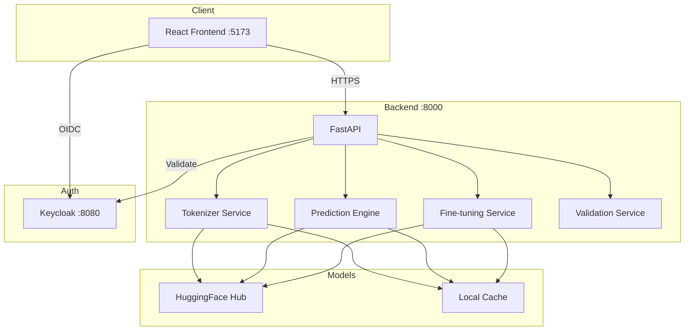

# Kronos Tensor Lab

> Work in progress. This checkpoint may be incomplete or fail tests. See PLAN.md and STATUS.md before use.


## Project Structure
```
.
├── backend/           # FastAPI application
│   ├── app/
│   │   ├── main.py           # App factory
│   │   ├── api/              # API routes
│   │   ├── services/         # Business logic
│   │   ├── models/           # Data models
│   │   └── core/             # Core utilities
│   ├── tests/                # Pytest tests
│   └── requirements.txt
├── frontend/          # React + TypeScript + Vite
│   ├── src/
│   │   ├── api/              # Typed API client
│   │   ├── components/       # React components
│   │   ├── pages/            # Page components
│   │   └── test/             # Test setup
│   ├── package.json
│   └── vite.config.ts
├── keycloak/          # Keycloak realm import
├── docker-compose.yaml
├── Dockerfile.backend
├── Dockerfile.frontend
└── .github/workflows/ci.yml
```

## Quick Start

### Prerequisites
- Docker & Docker Compose
- Or locally: Python 3.12, Node 24

### Using Docker Compose (Recommended)
```bash
docker compose up --build
```
Services:
- Frontend: http://localhost:5173
- Backend API: http://localhost:8000
- Keycloak: http://localhost:8080 (admin/admin)

### Local Development

#### Backend
```bash
cd backend
python -m venv .venv
source .venv/bin/activate
pip install -r requirements.txt
PYTHONPATH=. python -m uvicorn app.main:app --reload --port 8000
```

#### Frontend
```bash
cd frontend
npm install
npm run dev
```

#### Run Tests

Backend:
```bash
cd backend
.venv/bin/python -m pytest tests/ -v
```

Frontend:
```bash
cd frontend
npm test
```

## Architecture



## API Endpoints

### Health
- `GET /health` - Service health check
- `GET /api/v1/health` - API health check

### Tokenizer (Planned)
- `POST /api/v1/tokenize` - Encode OHLCV to tokens
- `POST /api/v1/detokenize` - Decode tokens to OHLCV

### Prediction (Planned)
- `POST /api/v1/predict` - Generate predictions with sampling

### Fine-tuning (Planned)
- `POST /api/v1/finetune` - Start fine-tuning job
- `GET /api/v1/finetune/{job_id}` - Get job status

### Validation (Planned)
- `GET /api/v1/validation/metrics` - Get backtest metrics
- `GET /api/v1/validation/dataset` - Get validation dataset

## AI/ML Evaluation

This application implements tooling for the **Kronos** foundation model (https://github.com/shiyu-coder/Kronos), a transformer-based model for financial time-series forecasting.

### Reproducible Evaluation Command
```bash
# Coming in future rounds: validation dataset download and backtest script
python -m backend.app.scripts.run_validation --dataset kronos-eth-validation --checkpoint <path>
```

### Baseline Metrics (from upstream Issue #78)
- **Samples evaluated**: 1250
- **Total predicted points**: 75000
- **MAE**: 34.26
- **RMSE**: 53.52
- **MAPE**: 1.29%
- **Correlation**: 0.9981

### Known Limitations (from upstream issues)
- Issue #92: Variable context length requires 400/120 ratio for continuity
- Issue #145: Fine-tuned predictions can be overly flat (T=1.0, top_p=0.95)
- Issue #164: HuggingFace model download sometimes fails
- Issue #68: Market-specific training data impact unclear
- Issue #299: Algorithm better suited for backtesting than live prediction

## Security
- OIDC authentication via Keycloak with PKCE
- Role-based access: viewer, operator, admin
- No secrets in repository (use .env)
- Non-root Docker containers
- CORS restricted to frontend origin

## License
MIT License - Copyright (c) 2026 Alan Vo <alanvo@gmail.com>